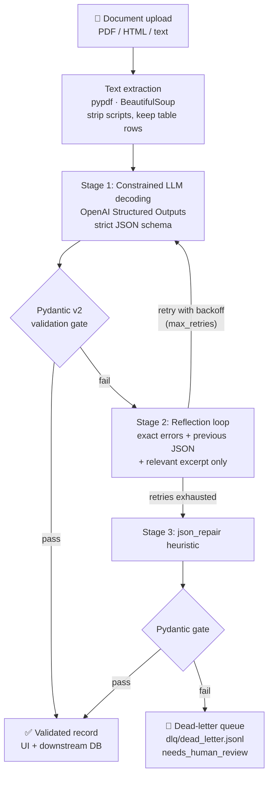

# 🧾 Structured Data Extractor

A fault-tolerant pipeline that turns **messy PDF and HTML invoices** into **strictly validated Pydantic v2 records**. When the LLM gets something wrong, the pipeline corrects itself with a reflection loop. When it can't be fixed, it routes the document to a **dead-letter queue** instead of crashing or saving bad data.

- **Live demo:** https://patience-invoice-extractor.streamlit.app
- **Video walkthrough:** https://youtu.be/r8RoRYtuJnA

## System architecture & data flow



| Status | Meaning |
|---|---|
| `SUCCESS` | Valid on attempt 1 |
| `REPAIRED_VIA_REFLECTION` | Fixed by a corrective re-prompt (attempt 2 or later) |
| `REPAIRED_VIA_HEURISTIC` | Fixed by `json_repair` without another LLM call |
| `DLQ_FAILED` | Nothing valid; written to the DLQ, `validated_data=None` |

## Project structure

```
structured-data-extractor/
├── pyproject.toml / uv.lock        # uv, Python 3.11
├── .env.example                    # copy to .env, add your key
├── ai_prompt_log.md                # AI prompt + code audit
├── Dockerfile / docker-compose.yml # container alternative
├── samples/
│   ├── invoice_messy.pdf           # $ symbols, "12th of Oct", discount, multi-line address
│   ├── invoice_clean.pdf           # golden document
│   ├── vendor_contract.html        # EUR, German labels, "1.150,00 €", scripts/nav noise
│   └── irrecoverable.txt           # not an invoice → DLQ
├── scripts/make_samples.py         # regenerates the PDFs
├── src/
│   ├── schemas.py                  # Pydantic v2 data contract
│   ├── extractor.py                # ingestion + SchemaExtractor engine
│   ├── fallback.py                 # reflection prompt, json_repair, DLQ
│   └── app.py                      # Streamlit UI
└── tests/
    ├── test_extraction.py          # parsing & schema enforcement
    └── test_fallbacks.py           # reflection, DLQ, backoff, repair
```

## Installation & setup (uv, Python 3.11+)

```bash
git clone https://github.com/patie03/structured-data-extractor.git
cd structured-data-extractor
uv python pin 3.11
uv sync                      # creates .venv from uv.lock
cp .env.example .env         # then paste your OPENAI_API_KEY into .env
```

## Execution commands

```bash
uv run streamlit run src/app.py   # web app → http://localhost:8501
uv run pytest -v                  # test suite (no API key needed: the LLM is mocked)
uv run pytest -m live -v          # optional: 1 real OpenAI call on the messy invoice
```

Docker alternative:

```bash
docker compose up --build                          # app on http://localhost:8501
docker compose --profile test run --rm tests       # tests inside the container
```

## Schema specification

**`LineItem`**

| Field | Type | Rules |
|---|---|---|
| `description` | `str` | at least 1 character, whitespace stripped |
| `quantity` | `int` | `> 0` |
| `unit_price` | `float` | `> 0`; `"$249.50"` is cleaned to `249.5` |
| `line_total` | `float` | `≥ 0`; **must equal `quantity × unit_price` within 0.02** |

**`InvoiceExtraction`** (`extra="forbid"`: unknown keys are rejected)

| Field | Type | Rules |
|---|---|---|
| `invoice_number` | `str` | regex `^[A-Z0-9][A-Z0-9\-/]{2,31}$`; "Inv No: inv 2024-0817" is cleaned to `2024-0817` |
| `vendor_name` | `str` | at least 2 characters |
| `invoice_date` | `date` | ISO-8601; pre-parser accepts "12th of Oct, 2024", "03.10.2024" and similar |
| `due_date` | `date \| None` | must not be before `invoice_date` |
| `billing_address` | `str \| None` | |
| `line_items` | `list[LineItem]` | at least 1 item |
| `subtotal` | `float` | `≥ 0` |
| `discount_amount` | `float` | `≥ 0`; "-$124.37" is stored as `124.37` |
| `tax_rate_percent` | `float \| None` | 0–100; "8.25%" becomes `8.25` |
| `tax_amount` | `float` | `≥ 0` |
| `total_amount` | `float` | `> 0` |
| `currency` | `Literal["USD","EUR","GBP"]` | `$`, `€`, `£`, "euro" and similar are mapped to codes |

**Cross-field `@model_validator(mode="after")`**, with a 0.02 tolerance:
1. `sum(line_total) == subtotal`
2. `subtotal − discount_amount + tax_amount == total_amount`
3. `due_date >= invoice_date`

## Web UI features

- Upload a PDF or HTML file, pick a sample, or paste raw text or HTML.
- Turn the **reflection loop** on or off, and set the maximum number of attempts.
- **Side-by-side view** of the raw document and the validated JSON, plus a line-item table.
- **Reconciliation badge:** green when the math matches, red with the difference when it doesn't.
- **Audit log:** each attempt shows its stage, the Pydantic errors, the exact prompt sent, and the raw model response.
- **"Inject a bad first answer":** corrupts the real model's first JSON so you can watch the reflection loop self-heal.
- **"🧨 Simulate Edge Case Failure":** sends an irrecoverable input through the pipeline to show DLQ routing.
- **Dead-letter queue viewer** with a download button.

## AI audit log summary

The baseline code was generated with Claude from the course prompt, then audited. Full details are in [`ai_prompt_log.md`](ai_prompt_log.md).

1. **Wrong reconciliation formula in the prompt:** it ignored discounts, so valid invoices would be rejected. Now line items must equal the subtotal, and subtotal − discount + tax must equal the total.
2. **`json_object` mode is not constrained decoding:** switched to strict Structured Outputs with a closed JSON schema.
3. **Context stuffing in retries:** reflection prompts now send only the errors, the previous JSON, and the relevant lines of the document (2,500 characters at most).
4. **Silent half-empty objects in "partial extraction":** removed. Failures go to the DLQ with `validated_data=None`.
5. **Fragile date and money coercion:** added `mode="before"` pre-parsers. Testing also caught a real bug: European `"1.150,00"` was being parsed as `1.15`.
6. **Pydantic v1 vs v2:** verified there is no v1 syntax (`@validator`, `.dict()`, `class Config`).

## Deployment

Deployed on **Streamlit Community Cloud**. Main file: `src/app.py`. `OPENAI_API_KEY` is stored in the app's **Secrets** settings, never in the repository.
